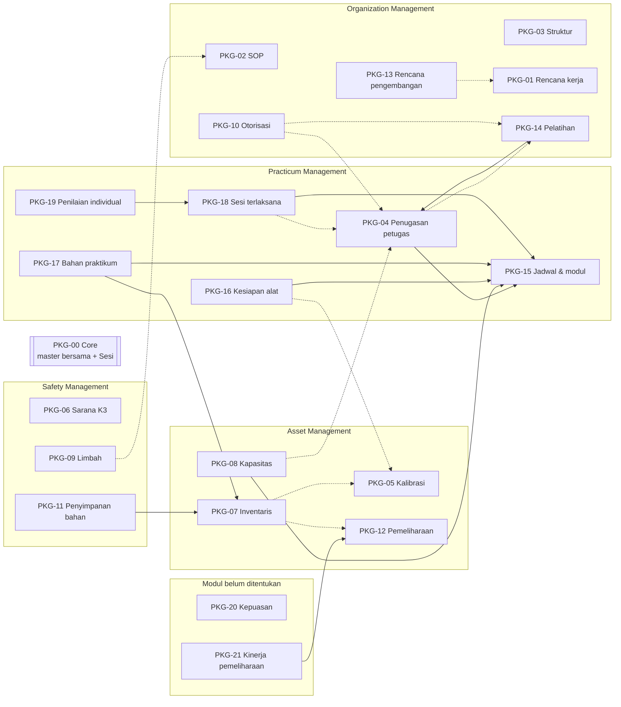
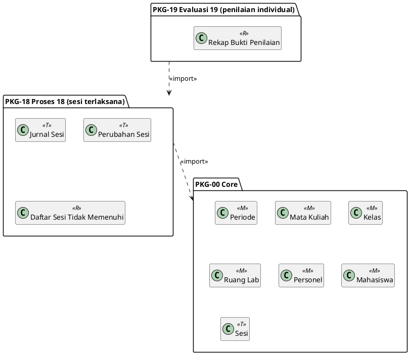

# Pemetaan Package per Instrumen Monev (Draf)

28 Oktober 2026 · Draf oleh Febriyan, untuk dibahas bersama kelompok dan dosen pembimbing

Sumber: **Instrumen Monev Laboratorium UPNVJ 2026 v1.1 – PIC dan Data** (tab *Analysis*), kolom *Entity Table* dan *Master Data*. Konvensi penamaan mengikuti [pedoman pengisian sheet analisis](pedoman-pengisian-sheet-analisis.md).

---

## 1. Tujuan dan aturan main

Dosen meminta pemetaan **per package**, dengan aturan berikut:

- **1 package = 1 instrumen monev.**
- Isi package adalah **entitas yang berkaitan dengan instrumen itu**. Isinya cukup nama entitas, **tanpa atribut**. Atribut dibahas di tahap berikutnya.

Kalau digambar dengan UML, hasilnya adalah ***package diagram***. Setiap package digambar sebagai map (persegi bertab). Di dalamnya ada kotak-kotak *class* yang hanya berisi nama. Panah putus-putus «import» menunjukkan package yang memakai entitas milik package lain.

### Langkah yang dipakai di dokumen ini

| Langkah | Yang dilakukan | Contoh |
|---|---|---|
| 1 | Ambil semua instrumen yang sudah punya PIC dan entitas di sheet. Hasilnya **21 instrumen**, menjadi PKG-01 sampai PKG-21 | Pengelolaan 1 → PKG-01 |
| 2 | Masukkan entitas transaksi [T] dan report [R] milik instrumen ke package-nya | Jurnal Sesi [T] → PKG-18 |
| 3 | Samakan nama master dengan **nama baku** (pedoman bagian 4b). Sinonim digabung | "master alat ukur", "master peralatan", "master daftar alat" → **Alat** |
| 4 | Master yang dipakai **≥ 2 package** dipindah ke package bersama, **PKG-00 Core**. Master yang hanya dipakai satu package tetap di package itu (**master lokal**) | Personel → Core; Template Pemeliharaan → lokal PKG-12 |
| 5 | Kalau satu entitas muncul di beberapa instrumen, pilih **satu pemilik**. Package lain cukup meng-*import* | Matriks Kompetensi muncul di ID 4 dan 14 → dimiliki PKG-04, di-*import* PKG-14 |
| 6 | Catat dependensi antar package, dibedakan **wajib** dan **opsional**. Dependensi hanya dihitung ke entitas [T]/[R] milik package lain. Master Core tidak dihitung, karena semua package memakai Core | PKG-21 wajib memakai data pemeliharaan PKG-12 |

### Label

| Label | Arti |
|---|---|
| **[T]** | Transaksi: kejadian berulang yang bertanggal atau berstatus |
| **[M]** | Master: data acuan yang dipilih oleh transaksi |
| **[R]** | Report: hasil olahan dari T dan M, tidak diinput |
| **(anak: …)** | Tabel anak yang ditulis di dalam induknya, tidak dihitung terpisah |
| **(+)** | Tambahan usulan penulis, **tidak ada di sheet**. Perlu disetujui PIC instrumen |
| **(?)** | Ada di sheet, tetapi diusulkan diubah. Alasannya ada di baris *Catatan* |

---

## 2. Ringkasan package

T, M, dan R hanya menghitung entitas **milik** package, bukan yang di-*import*.

| Package | Instrumen | PIC analisis | Modul | T | M lokal | R | Dependensi package |
|---|---|---|---|---|---|---|---|
| **PKG-00** | **Core (master bersama)**, bukan instrumen | Disepakati bersama | Lintas modul | 1 | 15 | 0 | — |
| PKG-01 | Pengelolaan 1 (rencana kerja tahunan) | Febriyan | Organization | 3 | 1 | 1 | — |
| PKG-02 | Pengelolaan 2 (SOP dan IK) | Febriyan | Organization | 3 | 0 | 1 | — |
| PKG-03 | Pengelolaan 3 (struktur organisasi) | Febriyan | Organization | 3 | 0 | 2 | — |
| PKG-04 | Pengelolaan 4 (penugasan petugas sesuai kompetensi) | Zahir | Practicum | 3 | 0 | 3 | 15 · opsional 14 |
| PKG-05 | Pengelolaan 5 (kalibrasi alat ukur) | Wisnu | Asset | 2 | 0 | 1 | — |
| PKG-06 | Pengelolaan 6 (sarana keselamatan) | Wisnu | Safety | 2 | 2 | 1 | — |
| PKG-07 | Pengelolaan 7 (inventaris alat dan bahan) | Wisnu | Asset | 3 | 0 | 2 | opsional 05, 12 |
| PKG-08 | Pengelolaan 8 (kapasitas sesi) | Patih | Asset | 4 | 2 | 2 | 15 · opsional 04 |
| PKG-09 | Pengelolaan 9 (limbah) | Patih | Safety | 5 | 3 | 2 | opsional 02 |
| PKG-10 | Pengelolaan 10 (otorisasi personel) | Zahir | Organization | 3 | 2 | 1 | opsional 04, 14 |
| PKG-11 | Pengelolaan 11 (penyimpanan bahan) | Wisnu | Safety | 2 | 1 | 1 | 07 |
| PKG-12 | Pengelolaan 12 (pemeliharaan preventif alat) | Patih | Asset | 4 | 1 | 3 | — |
| PKG-13 | Pengembangan 13 (rencana pengembangan lab) | Herrens | Organization | 3 | 0 | 1 | opsional 01 |
| PKG-14 | Pengembangan 14 (pelatihan PLP/laboran) | Herrens | Organization | 3 | 0 | 0 | 04 |
| PKG-15 | Persiapan 15 (jadwal dan modul) | Herrens | Practicum | 2 | 0 | 2 | — |
| PKG-16 | Persiapan 16 (kesiapan alat dan *software*) | Zahir | Practicum | 3 | 1 | 0 | 15 · opsional 05 |
| PKG-17 | Persiapan 17 (bahan praktikum) | Zahir | Practicum | 2 | 0 | 0 | 07, 15 |
| PKG-18 | Proses 18 (sesi terlaksana) | Febriyan | Practicum | 2 | 0 | 1 | 15 · opsional 04 |
| PKG-19 | Evaluasi 19 (penilaian individual praktikan) | Febriyan | Practicum | 0 | 0 | 1 | 18 |
| PKG-20 | Evaluasi 20 (kepuasan pengguna) | Patih | *belum ada* | 5 | 3 | 2 | — |
| PKG-21 | Evaluasi 21 (kinerja pemeliharaan) | Herrens | *belum ada* | 3 | 0 | 1 | 12 |

Nomor PKG sengaja disamakan dengan nomor instrumen. Nomor di sheet tidak unik, jadi **kata kunci di dalam kurung wajib ikut disebut**. Contoh: PKG-08 adalah Pengelolaan 8 (**kapasitas sesi**), bukan Pengelolaan 8 (pemeliharaan ruang).

PKG-xx di sini **berbeda** dengan kode paket M01–M21 di folder Drive "Paket Dokumen Monev".

---

## 3. Gambaran dependensi

Panah berarti "memakai entitas [T]/[R] dari". Garis tegas = wajib, garis putus-putus = opsional. Semua package juga meng-*import* PKG-00 Core. Panah ke Core tidak digambar supaya diagram tetap terbaca.

Yang terlihat dari diagram:
- **PKG-15 (jadwal)** adalah hulu kelompok praktikum. Lima package memakai Sesi yang dibangkitkannya.
- **PKG-07 (inventaris)** dan **PKG-12 (pemeliharaan)** adalah hulu untuk kelompok aset dan bahan.
- **PKG-03 (struktur)** tidak terlihat di diagram, tetapi justru **paling hulu**: ia mengelola master Personel dan Jabatan di Core, yang dipakai 11 package lain. Hal yang sama berlaku untuk PKG-07 sebagai pengelola master Alat dan Bahan (bagian 4, kolom *Dikelola oleh*).
- **PKG-19** dan **PKG-21** berada paling hilir. Keduanya hampir sepenuhnya memakai data package lain.
- **PKG-20 (kepuasan)** berdiri sendiri. Dependensinya hanya ke Core.

---

## 4. PKG-00 Core: master bersama

Isinya master yang dipakai **lebih dari satu package**. Kolom **Dikelola oleh** menunjukkan package yang bertanggung jawab atas isi dan aturan master itu. Biasanya package ini yang paling hulu atau yang menjadikan master itu inti indikatornya.

| Entitas | Arti singkat | Dikelola oleh | Dipakai oleh | Sumber yang sudah ada |
|---|---|---|---|---|
| Periode [M] | Semester/tahun akademik, tahun anggaran, periode monev | Core | 01, 13, 14, 15, 18, 20, 21 | `mst_periodesemt` (modul Rafika) |
| Mata Kuliah [M] | MK praktikum | Core | 04, 15, 17, 18, 20 | `mst_coursesemt` |
| Kelas [M] | Kelas per MK per periode, beserta jumlah mahasiswa | Core | 04, 08, 15, 18, 19, 20 | `mst_kodekelas` |
| Ruang Lab [M] | 8 ruang FIKLAB beserta kapasitasnya | Core | 02, 06, 07, 08, 09, 15, 16, 18, 20 | `lab.master.ruangan` |
| Personel [M] | Semua orang yang berperan di lab: KaLab, PLP/laboran, dosen, asisten, petugas K3 | **PKG-03** | 01, 02, 03, 04, 06, 07, 10, 13, 14, 15, 18, 21 | Tersebar: `mst_dosen`, `op.student.assistant`, `res.users`. Laboran belum ada |
| Jabatan [M] | Jabatan/peran, termasuk uraian tugas, kewenangan, atasan, pengganti, dan syarat kompetensi minimum | **PKG-03** | 01, 02, 03, 04, 13, 14, 18 | `mst_role` hanya berisi nama peran |
| Kompetensi [M] | Jenis kompetensi, sertifikat, atau pelatihan yang disyaratkan | **PKG-04** | 04, 10, 14 | Belum ada |
| Mahasiswa [M] | Praktikan | Core | 10, 18 (opsional) | `op.student` |
| Dokumen Induk [M] | Daftar induk dokumen terkendali: SOP, IK, formulir, SK | **PKG-02** | 02, 03, 09 | Belum ada |
| KPI [M] | Definisi indikator kinerja lab | **PKG-01** | 01, 21 | Belum ada |
| Alat [M] | Peralatan dan perangkat lab, termasuk penanda "perlu kalibrasi", "berkewenangan khusus", dan "stasiun kerja" | **PKG-07** | 05, 07, 08, 10, 12, 16, 21 | Belum ada di modul kita. Perlu dicek terhadap templat *Integrated_Kalibrasi_Inventory* KaLab |
| Bahan [M] | Bahan habis pakai atau reagen | **PKG-07** | 07, 11, 17 | Belum ada |
| Lokasi Penyimpanan [M] (+) | Lokasi selain ruang: lemari, rak khusus, kulkas, TPS limbah | Core | 07, 09, 11 | Belum ada |
| Mitra Eksternal [M] (+) | Pihak luar: vendor kalibrasi, teknisi/vendor servis, pengelola limbah berizin | Core | 05, 09, 12 | `res.partner` (bawaan Odoo) |
| Indikator Monev [M] (+) | Registri 64 indikator: aspek, nomor, kata kunci, jenis skor | Core | Semua package, dan *dashboard* | Belum ada |
| **Sesi [T]** | Satu sesi praktikum bertanggal. Satu-satunya **transaksi** di Core | Dibangkitkan oleh **PKG-15** | 04, 08, 15, 16, 17, 18, 19 | `op.session` (OpenEduCat, sudah dipakai modul Rafika) |

**Kenapa Sesi ditaruh di Core, padahal transaksi?** Di sheet, Sesi diklaim tiga instrumen sekaligus: ID 4 ("Sesi"), ID 15 ("Jadwal"), dan ID 18 ("Sesi Praktikum"). Padahal sesi yang dimaksud ketiganya sama, dan ada enam package yang membutuhkannya. Kalau Sesi masuk ke salah satu package, package lain jadi bergantung penuh pada pemiliknya. Usulannya: Sesi menjadi entitas bersama yang meng-*inherit* `op.session`. PKG-15 membangkitkan dan memublikasikannya, PKG-04 menempelkan petugas, dan PKG-18 mencatat pelaksanaannya.

---

## 5. Isi tiap package

Setiap package dijelaskan dengan format yang sama:

- **Milik package**: entitas yang dibuat dan dikelola package ini.
- **Import Core**: master bersama yang dipakai.
- **Import package lain**: entitas milik package lain yang dipakai.
- **Dipakai oleh**: package lain yang memakai entitas package ini.

### Aspek Pengelolaan Laboratorium

#### PKG-01 · Pengelolaan 1 (rencana kerja tahunan)

| | |
|---|---|
| Target | Rencana kerja tahunan memuat sasaran, KPI, target, anggaran, dan penanggung jawab |
| PIC · Modul | Febriyan · Organization Management |
| Milik package | [T] Rencana Kerja (anak: item rencana) [T] Realisasi Rencana Kerja [T] Tinjauan Rencana Kerja [R] Dokumen Rencana Kerja |
| Master lokal | [M] Sasaran Renstra |
| Import Core | Periode, KPI (dikelola di sini), Personel, Jabatan |
| Import package lain | — |
| Dipakai oleh | Opsional PKG-13 (keterkaitan *roadmap*). KPI yang dikelola di sini juga dipakai PKG-21 lewat Core |
| Catatan | *Roadmap* dan rencana tahunan cukup satu entitas Rencana yang dibedakan jenisnya |

#### PKG-02 · Pengelolaan 2 (SOP dan instruksi kerja)

| | |
|---|---|
| Target | SOP dan IK tersedia, disahkan, mutakhir, dan dapat diakses pengguna |
| PIC · Modul | Febriyan · Organization Management |
| Milik package | [T] Versi SOP [T] Distribusi SOP [T] Sosialisasi SOP (anak: peserta) [R] Daftar SOP Tidak Memenuhi |
| Master lokal | — |
| Import Core | Dokumen Induk (dikelola di sini), Ruang Lab, Personel, Jabatan |
| Import package lain | — |
| Dipakai oleh | Opsional PKG-09 (versi SOP limbah). Dokumen Induk yang dikelola di sini juga dipakai PKG-03 (file SK) lewat Core |
| Catatan | Kategori SOP adalah pilihan tetap, bukan master |

#### PKG-03 · Pengelolaan 3 (struktur organisasi, tugas, dan wewenang)

| | |
|---|---|
| Target | Struktur organisasi, tugas, tanggung jawab, wewenang, dan pengganti ditetapkan dan dijalankan |
| PIC · Modul | Febriyan · Organization Management |
| Milik package | [T] SK Penetapan Pengelola (anak: personel–jabatan beserta periode berlaku) [T] Rapat Koordinasi [T] Evaluasi Struktur [R] Bagan Organisasi [R] Matriks Kewenangan |
| Master lokal | — |
| Import Core | Personel dan Jabatan (keduanya dikelola di sini), Dokumen Induk |
| Import package lain | — |
| Dipakai oleh | Tidak ada yang memakai [T]/[R]-nya, tetapi Personel dan Jabatan yang dikelola di sini dipakai 11 package lain lewat Core |
| Catatan | **Package paling hulu.** Keputusan model Personel (pakai `hr.employee`, model sendiri, atau model Rafika) harus diambil di sini lebih dulu |

#### PKG-04 · Pengelolaan 4 (penugasan petugas sesuai kompetensi)

| | |
|---|---|
| Target | Setiap sesi praktikum punya laboran/PLP dan asisten yang ditugaskan sesuai kompetensi minimum |
| PIC · Modul | Zahir · Practicum Management |
| Milik package | [T] Seleksi Kompetensi Petugas [T] Penugasan Petugas (?) [T] Komitmen Petugas Praktikum [R] Daftar Sesi dan Petugas [R] Surat Tugas [R] Matriks Kompetensi |
| Master lokal | — |
| Import Core | Sesi, Mata Kuliah, Kelas, Personel, Jabatan (syarat kompetensi minimum), Kompetensi (dikelola di sini) |
| Import package lain | PKG-15 (Sesi bertanggal) · opsional PKG-14 (kompetensi hasil pelatihan) |
| Dipakai oleh | PKG-14 (Matriks Kompetensi) · opsional PKG-08, 10, 18 |
| Catatan | (?) Di sheet ada "Petugas (Master)" dan "Petugas (Transaksi)". Usulannya: orangnya cukup master **Personel**, sedangkan penugasan per sesi menjadi **Penugasan Petugas [T]**. Bukti 7 (orientasi dan supervisi) belum punya entitas |

#### PKG-05 · Pengelolaan 5 (kalibrasi alat ukur)

| | |
|---|---|
| Target | Alat ukur yang perlu kalibrasi punya kalibrasi berlaku dan hasilnya memenuhi kebutuhan |
| PIC · Modul | Wisnu · Asset Management |
| Milik package | [T] Program Kalibrasi [T] Kalibrasi Alat (anak: evaluasi hasil terhadap toleransi, tindak lanjut koreksi) [R] Laporan Status Kalibrasi Alat |
| Master lokal | — |
| Import Core | Alat (bertanda "perlu kalibrasi"), Mitra Eksternal (vendor kalibrasi) |
| Import package lain | — |
| Dipakai oleh | Opsional PKG-07 (status kalibrasi di inventaris) · opsional PKG-16 (status kalibrasi sebelum sesi) |
| Catatan | (?) "Master alat ukur" digabung ke **Alat**. "Master status kalibrasi" cukup pilihan tetap. "Master vendor kalibrasi" digabung ke **Mitra Eksternal** |

#### PKG-06 · Pengelolaan 6 (sarana keselamatan dan kedaruratan)

| | |
|---|---|
| Target | Sarana keselamatan dan kedaruratan diinspeksi dan berfungsi sesuai jadwal |
| PIC · Modul | Wisnu · Safety Management |
| Milik package | [T] Inspeksi Sarana Keselamatan (anak: hasil *checklist*; lampiran foto) [T] Catatan Perbaikan K3 [R] Daftar Kebutuhan Sarana Keselamatan |
| Master lokal | [M] Sarana Keselamatan [M] Kategori Bahaya / HIRA |
| Import Core | Ruang Lab, Personel (petugas K3) |
| Import package lain | — |
| Dipakai oleh | — |
| Catatan | Kategori Bahaya mirip "karakteristik bahan" (PKG-11) dan "sifat bahaya limbah" (PKG-09). Ketiganya kandidat digabung menjadi satu master bersama |

#### PKG-07 · Pengelolaan 7 (inventaris alat dan bahan)

| | |
|---|---|
| Target | Inventaris alat dan bahan lengkap, mutakhir, dan sesuai pemeriksaan fisik |
| PIC · Modul | Wisnu · Asset Management |
| Milik package | [T] Kartu Stok Bahan [T] Riwayat Mutasi Alat [T] Pemeriksaan Fisik / *Stock Opname* (anak: penyesuaian stok; lampiran berita acara) [R] Daftar Inventaris Alat (+) [R] Laporan Mutasi dan *Stock Opname* |
| Master lokal | — |
| Import Core | Alat dan Bahan (keduanya dikelola di sini), Ruang Lab, Lokasi Penyimpanan, Personel (penanggung jawab alat) |
| Import package lain | Opsional PKG-05 (status kalibrasi) · opsional PKG-12 (status pemeliharaan) |
| Dipakai oleh | PKG-11 (kartu stok) · PKG-17 (stok bahan) |
| Catatan | (+) Bukti 1 (inventaris alat beserta kondisi dan status) adalah hasil olahan master Alat, jadi ditulis sebagai [R] |

#### PKG-08 · Pengelolaan 8 (kapasitas sesi)

| | |
|---|---|
| Target | Setiap sesi praktikum sesuai kapasitas, ketersediaan stasiun/alat, dan kapasitas supervisi |
| PIC · Modul | Patih · Asset Management |
| Milik package | [T] Analisis Kapasitas [T] Verifikasi Kapasitas Sesi [T] Pembagian Kelompok [T] Pengecualian Kapasitas [R] Rekap Kepatuhan Kapasitas [R] Daftar Sesi Melebihi Kapasitas |
| Master lokal | [M] Profil Kapasitas Lab [M] Aturan Rasio Supervisi |
| Import Core | Ruang Lab, Alat (stasiun kerja), Sesi, Kelas (jumlah peserta) |
| Import package lain | PKG-15 (Sesi) · opsional PKG-04 (jumlah petugas untuk rasio supervisi) |
| Dipakai oleh | — |
| Catatan | Profil Kapasitas Lab bisa saja cukup menjadi bagian dari Ruang Lab, dan Aturan Rasio Supervisi cukup menjadi pengaturan KaLab. Perlu dicek ke PIC |

#### PKG-09 · Pengelolaan 9 (limbah)

| | |
|---|---|
| Target | Limbah diidentifikasi, dipilah, disimpan, dan ditangani sesuai sifat bahaya dan ketentuan |
| PIC · Modul | Patih · Safety Management |
| Milik package | [T] Mekanisme Pengelolaan Limbah (?) [T] Pencatatan Limbah [T] Serah Terima Limbah [T] Inspeksi Kepatuhan Limbah [T] Evaluasi dan Tindak Lanjut [R] Daftar Jenis dan Sumber Limbah [R] Neraca Limbah |
| Master lokal | [M] Kategori Limbah [M] Sumber Limbah [M] Wadah dan Label |
| Import Core | Lokasi Penyimpanan, Mitra Eksternal (pengelola limbah), Ruang Lab |
| Import package lain | Opsional PKG-02 (SOP limbah sebagai dokumen terkendali) |
| Dipakai oleh | — |
| Catatan | (?) "Mekanisme pengelolaan limbah" adalah SOP, jadi kandidat dipindah menjadi Dokumen Induk berkategori limbah di PKG-02. "Sumber Limbah" (ruang + kegiatan) bisa cukup berupa relasi ke Ruang Lab |

#### PKG-10 · Pengelolaan 10 (otorisasi personel sesuai kompetensi)

| | |
|---|---|
| Target | Personel/pengguna yang menjalankan tugas atau alat berkewenangan khusus punya otorisasi sesuai kompetensi |
| PIC · Modul | Zahir · Organization Management |
| Milik package | [T] Asesmen Keterampilan Personel [T] Otorisasi Personel [T] Evaluasi Ulang Otorisasi [R] Daftar Operator Sah |
| Master lokal | [M] Tugas/Alat Berkewenangan Khusus (di sheet: "Matriks Tugas/Alat Berkewenangan Khusus") [M] Jenis/Level Otorisasi |
| Import Core | Personel, Mahasiswa (praktikan), Alat, Kompetensi |
| Import package lain | Opsional PKG-04 (hasil seleksi kompetensi) · opsional PKG-14 (sertifikat pelatihan) |
| Dipakai oleh | — |
| Catatan | Asesmen Keterampilan mirip dengan Seleksi Kompetensi di PKG-04. Perlu diputuskan apakah keduanya digabung. Bukti 4 (pembatasan akses) bisa memakai grup keamanan Odoo |

#### PKG-11 · Pengelolaan 11 (penyimpanan bahan)

| | |
|---|---|
| Target | Bahan disimpan dan diidentifikasi sesuai karakteristik, bahaya, kompatibilitas, dan masa pakainya |
| PIC · Modul | Wisnu · Safety Management |
| Milik package | [T] Inspeksi Penyimpanan Bahan (anak: *checklist* kondisi; lampiran SDS) [T] Log Penggunaan dan Penyimpanan Bahan (?) [R] Daftar SDS dan Label Bahan |
| Master lokal | [M] Karakteristik Bahaya Bahan |
| Import Core | Bahan, Lokasi Penyimpanan |
| Import package lain | PKG-07 (Kartu Stok Bahan) |
| Dipakai oleh | — |
| Catatan | (?) Log Penggunaan Bahan tumpang tindih dengan Kartu Stok Bahan di PKG-07, jadi kandidat digabung ke sana. Karakteristik Bahaya kandidat digabung dengan Kategori Bahaya di PKG-06 |

#### PKG-12 · Pengelolaan 12 (pemeliharaan preventif alat)

| | |
|---|---|
| Target | Pemeliharaan preventif peralatan dilaksanakan sesuai jadwal dan diverifikasi hasilnya |
| PIC · Modul | Patih · Asset Management |
| Milik package | [T] Program Pemeliharaan [T] Pelaksanaan Pemeliharaan [T] Verifikasi Fungsi [T] Laporan Kerusakan dan Perbaikan [R] Rekap Kepatuhan Pemeliharaan [R] Riwayat Pemeliharaan per Alat [R] Daftar Pekerjaan Terlambat |
| Master lokal | [M] Template Pemeliharaan |
| Import Core | Alat, Mitra Eksternal (teknisi/vendor) |
| Import package lain | — |
| Dipakai oleh | PKG-21 (wajib) · opsional PKG-07 |
| Catatan | (?) Teknisi internal adalah Personel, sedangkan vendor adalah Mitra Eksternal. "Master teknisi/vendor" di sheet dipecah ke dua master tersebut |

### Aspek Pengembangan Laboratorium

#### PKG-13 · Pengembangan 13 (rencana pengembangan lab)

| | |
|---|---|
| Target | Rencana pengembangan didasarkan pada analisis kesenjangan kebutuhan tridharma, kompetensi, sarana, dan layanan |
| PIC · Modul | Herrens · Organization Management |
| Milik package | [T] Rencana Pengembangan (anak: item rencana per aspek) [T] Realisasi Rencana Pengembangan [T] Tinjauan Rencana Pengembangan [R] Dokumen Rencana Pengembangan |
| Master lokal | — |
| Import Core | Periode, Personel, Jabatan |
| Import package lain | Opsional PKG-01 (*roadmap*) |
| Dipakai oleh | — |
| Catatan | (?) "Master aspek pengembangan" hanya berisi 4 nilai tetap, jadi cukup pilihan tetap. Polanya **sama persis** dengan PKG-01 (rencana, realisasi, tinjauan). Kandidat memakai satu model generik yang dibedakan jenisnya |

#### PKG-14 · Pengembangan 14 (pelatihan PLP/laboran)

| | |
|---|---|
| Target | Kompetensi PLP/laboran dikembangkan melalui pelatihan yang relevan dan dievaluasi penerapannya |
| PIC · Modul | Herrens · Organization Management |
| Milik package | [T] Rencana Pelatihan (anak: kebutuhan kompetensi per personel) [T] Realisasi Pelatihan (lampiran sertifikat) [T] Evaluasi Efektivitas Pelatihan |
| Master lokal | — |
| Import Core | Periode, Personel, Jabatan (kompetensi minimum), Kompetensi |
| Import package lain | PKG-04 (Matriks Kompetensi) |
| Dipakai oleh | Opsional PKG-04, PKG-10 |
| Catatan | (?) Di sheet, Matriks Kompetensi [R] ditulis di ID 4 dan ID 14. Diusulkan satu report milik PKG-04 yang membaca data dari kedua package |

### Aspek Persiapan Praktikum

#### PKG-15 · Persiapan 15 (jadwal dan modul)

| | |
|---|---|
| Target | Jadwal penggunaan lab dan modul praktikum tersedia sebelum setiap kegiatan |
| PIC · Modul | Herrens · Practicum Management |
| Milik package | [T] Rencana Pemakaian Lab (termasuk kegiatan selain praktikum dan persetujuannya) [T] Versi Modul Praktikum [R] Jadwal Terpadu (+) [R] Rekaman Konflik Jadwal |
| Master lokal | — |
| Import Core | **Sesi (dibangkitkan dan dipublikasikan di sini)**, Periode, Mata Kuliah, Kelas, Ruang Lab, Personel (dosen pengampu) |
| Import package lain | — |
| Dipakai oleh | PKG-04, 08, 16, 17, 18 (semua melalui Sesi) |
| Catatan | (?) Di sheet, "Jadwal" ditulis sebagai transaksi. Diusulkan jadwal sesi praktikum = **Sesi** di Core, dan Jadwal Terpadu = report gabungan Sesi + Rencana Pemakaian Lab. Versi Modul polanya sama dengan Versi SOP di PKG-02 |

#### PKG-16 · Persiapan 16 (kesiapan alat dan *software*)

| | |
|---|---|
| Target | Peralatan, *software*, dan utilitas dinyatakan siap sebelum setiap sesi |
| PIC · Modul | Zahir · Practicum Management |
| Milik package | [T] *Checklist* Kesiapan Sesi [T] Uji Fungsi Alat/*Software* [T] Keputusan Siap/Tunda Sesi |
| Master lokal | [M] *Software* dan Lisensi |
| Import Core | Sesi, Alat, Ruang Lab (utilitas) |
| Import package lain | PKG-15 (Sesi) · opsional PKG-05 (Laporan Status Kalibrasi Alat) |
| Dipakai oleh | — |
| Catatan | (?) "Status Kalibrasi Alat [R]" di sheet adalah report milik PKG-05, jadi cukup di-*import*. Keputusan Siap/Tunda bisa cukup menjadi bagian dari *checklist* kesiapan |

#### PKG-17 · Persiapan 17 (bahan praktikum)

| | |
|---|---|
| Target | Bahan praktikum tersedia dalam jumlah, mutu, dan kondisi yang sesuai sebelum sesi |
| PIC · Modul | Zahir · Practicum Management |
| Milik package | [T] Kebutuhan Bahan per Sesi [T] Penerimaan dan Substitusi Bahan |
| Master lokal | — |
| Import Core | Bahan, Sesi, Mata Kuliah |
| Import package lain | PKG-07 (stok bahan) · PKG-15 (Sesi) |
| Dipakai oleh | — |
| Catatan | (?) "Stok Bahan [R]" di sheet diambil dari Kartu Stok PKG-07. Instrumen ini **bersyarat** (hanya bila praktikum memakai bahan fisik), jadi kemungkinan besar N/A untuk lab FIK |

### Aspek Proses Praktikum

#### PKG-18 · Proses 18 (sesi terlaksana)

| | |
|---|---|
| Target | Sesi praktikum terlaksana sesuai jadwal, modul, dan waktu kegiatan |
| PIC · Modul | Febriyan · Practicum Management |
| Milik package | [T] Jurnal Sesi (anak: presensi praktikan/asisten/laboran/dosen, *log book*; tautan modul dan SIMPEL) [T] Perubahan Sesi (termasuk penunjukan sesi pengganti) [R] Daftar Sesi Tidak Memenuhi |
| Master lokal | — |
| Import Core | Sesi, Periode, Mata Kuliah, Kelas, Ruang Lab, Personel, Jabatan, Mahasiswa (opsional) |
| Import package lain | PKG-15 (Sesi rencana, **wajib**) · opsional PKG-04 (penugasan untuk dicocokkan dengan presensi) |
| Dipakai oleh | PKG-19 |
| Catatan | Sesi ditulis di sheet sebagai milik ID 18, tetapi dipindah ke Core (lihat bagian 4). Rincian ada di [analisis Proses 18](analisis-data-proses-18.md) |

### Aspek Evaluasi Praktikum

#### PKG-19 · Evaluasi 19 (penilaian individual praktikan)

| | |
|---|---|
| Target | Kompetensi praktikan dinilai secara individual melalui rubrik dan bukti unjuk kerja sesuai CPMK |
| PIC · Modul | Febriyan · Practicum Management |
| Milik package | «extend» Jurnal Sesi: tautan bukti penilaian (LeADS) [R] Rekap Bukti Penilaian per Kelas (+) |
| Master lokal | — |
| Import Core | Kelas, Sesi |
| Import package lain | PKG-18 (Jurnal Sesi, **wajib**) |
| Dipakai oleh | — |
| Catatan | Tidak ada tabel baru. Penilaian tetap di LeADS dan presensi rinci di SIMPEL. Package ini hanya menambah kolom tautan ke Jurnal Sesi. Ini tetap dihitung sebagai package sendiri karena 1 instrumen = 1 package |

#### PKG-20 · Evaluasi 20 (kepuasan pengguna)

| | |
|---|---|
| Target | Kepuasan pengguna lab diukur, dianalisis, dan dipakai untuk perbaikan layanan |
| PIC · Modul | Patih · *belum ditentukan* |
| Milik package | [T] Rencana Survei [T] Respons Survei (anak: jawaban per butir) [T] Keluhan Terbuka [T] Analisis Hasil Survei (?) [T] Rencana Tindak Lanjut [R] Rekap Hasil per Aspek [R] Perbandingan Antarperiode |
| Master lokal | [M] Aspek Survei [M] Instrumen Survei [M] Butir Pertanyaan |
| Import Core | Ruang Lab, Mata Kuliah, Kelas, Periode (+) |
| Import package lain | — |
| Dipakai oleh | — |
| Catatan | (?) Rerata per aspek, jumlah responden, dan *response rate* bisa dihitung, jadi Analisis Hasil kandidat [R]. Yang perlu diinput hanya kesimpulan analisisnya. Modul perlu ditentukan, atau diusulkan modul baru "Quality/Evaluation" |

#### PKG-21 · Evaluasi 21 (kinerja pemeliharaan)

| | |
|---|---|
| Target | Kinerja pemeliharaan dan keandalan alat dianalisis untuk memperbaiki jadwal dan kebutuhan penggantian |
| PIC · Modul | Herrens · *belum ditentukan* |
| Milik package | [T] Rekap Kinerja Pemeliharaan (?) [T] Analisis dan Tindak Lanjut Pemeliharaan (lampiran laporan analisis) [T] Tinjauan Dampak Perbaikan [R] Laporan Kinerja Pemeliharaan (termasuk perbandingan antarperiode) |
| Master lokal | — |
| Import Core | Periode, Alat, KPI, Personel |
| Import package lain | PKG-12 (data pemeliharaan dan kerusakan, **wajib**) |
| Dipakai oleh | — |
| Catatan | (?) *Downtime*, kerusakan, dan keterlambatan sudah ada di PKG-12, jadi Rekap Kinerja kandidat [R]. Yang perlu diinput hanya biaya, kalau biaya tidak dicatat di PKG-12. Modul kemungkinan Asset Management |

---

## 6. Entitas yang muncul di lebih dari satu instrumen

Ini daftar entitas yang di sheet ditulis lebih dari sekali, atau dengan nama berbeda untuk hal yang sama. Usulan pemiliknya perlu disepakati.

| Entitas | Muncul di sheet | Usulan pemilik | Yang lain |
|---|---|---|---|
| Sesi | ID 4 (Sesi), ID 15 (Jadwal), ID 18 (Sesi Praktikum) | **PKG-00 Core** | Semua meng-*import* |
| Matriks Kompetensi [R] | ID 4, ID 14 | PKG-04 | PKG-14 meng-*import* |
| Status Kalibrasi Alat [R] | ID 5 (Laporan Status Kalibrasi), ID 16 | PKG-05 | PKG-16 meng-*import* |
| Kartu Stok / Stok Bahan | ID 7 (Kartu Stok Bahan), ID 11 (Log Penggunaan Bahan), ID 17 (Stok Bahan) | PKG-07 | PKG-11 dan 17 meng-*import* |
| Rencana, Realisasi, Tinjauan | ID 1, ID 13 | Satu pola generik | Dibedakan jenisnya |
| Versi dokumen | ID 2 (Versi SOP), ID 15 (Modul versi berlaku) | Satu pola generik | Dibedakan jenisnya |
| Tindak lanjut / RTL | ID 6 (Catatan Perbaikan K3), ID 9 (Evaluasi dan Tindak Lanjut), ID 20 (RTL), ID 21 (Analisis dan Tindak Lanjut) | Kandidat entitas bersama "Tindak Lanjut" | Sangat relevan bila nanti Evaluasi E08 (RTL) diambil |
| Asesmen kompetensi | ID 4 (Seleksi Kompetensi), ID 10 (Asesmen Keterampilan) | Perlu diputuskan PIC (Zahir) | — |

## 7. Penyeragaman nama master

Nama di sheet dan nama baku yang dipakai di dokumen ini:

| Nama baku | Ditulis di sheet sebagai |
|---|---|
| Alat | master alat ukur (5), master peralatan (7, 21), master stasiun kerja/daftar alat (8), master daftar alat (12), master alat/perangkat lab (16), alat berkewenangan khusus (10, sebagian) |
| Bahan | master bahan (7, 11), master bahan/reagen (17) |
| Personel | master personel (semua), Petugas (Master) (4), master personel (petugas K3) (6), teknisi internal (12) |
| Mata Kuliah + Kelas | master mata kuliah (include kelas, jumlah mahasiswa) (4, 15, 18, 20) |
| Mitra Eksternal | master vendor kalibrasi (5), master pengelola limbah (9), master teknisi/vendor (12) |
| Lokasi Penyimpanan | master lokasi penyimpanan (9, 11), "ruang lab / lokasi" (7, sebagian) |
| Periode | master periode, master periode (tahun anggaran) |
| *Pilihan tetap, bukan master* | master status kalibrasi (5), master aspek pengembangan (13) |

---

## 8. Instrumen yang belum dipetakan

43 dari 64 baris belum punya entitas di sheet. Kolom terakhir **hanya dugaan awal**, yaitu ke package mana instrumen itu paling mungkin menempel kalau nanti diambil. Tujuannya membantu memperkirakan cakupan, bukan pembagian kerja.

| Aspek | Instrumen | Kandidat menempel ke |
|---|---|---|
| Pengelolaan | 8 (pemeliharaan ruang dan utilitas) | Pola PKG-12, untuk ruang |
| Pengelolaan | 10 (pemantauan KPI) | PKG-01 (KPI) |
| Pengelolaan | 10 (legalitas dan ruang lingkup) | PKG-03 |
| Pengelolaan | 12 (pengadaan dan penerimaan) | PKG-07, Mitra Eksternal |
| Pengelolaan | 13 (pengendalian dokumen mutu) | PKG-02 (Dokumen Induk) |
| Pengelolaan | 17 (ketertelusuran metrologi), PIC Patih, entitas belum diisi | PKG-05 |
| Pengelolaan | 18 (cek antara alat) | PKG-05 / PKG-12 |
| Pengelolaan | 19 (alat rusak/karantina) | PKG-12 (Laporan Kerusakan) |
| Pengelolaan | 20 (data, akses, *backup*) | Fitur bawaan Odoo (grup akses, *audit trail*, *backup*) |
| Pengembangan | 23 (risiko dan peluang) | PKG-06 (Kategori Bahaya / HIRA) |
| Pengembangan | 15 (inovasi metode/modul) | PKG-13 |
| Pengembangan | 26 (efisiensi kapasitas, energi, bahan) | PKG-08, 12, 18 (utilisasi) |
| Pengembangan | 18 (kerja sama fasilitas) | Mitra Eksternal |
| Pengembangan | 19 (layanan tridharma) | PKG-01 / PKG-03 |
| Pengembangan | 15 (arah akreditasi) | PKG-13 |
| Pengembangan | 30 (kesiapan kedaruratan) | PKG-06 |
| Persiapan | 22 (modul selaras RPS/CPMK) | PKG-15 (Versi Modul) |
| Persiapan | 35 (prasyarat praktikan) | PKG-10 / PKG-18 |
| Persiapan | 36 (APD) | PKG-06 / PKG-16 |
| Persiapan | 37 (*safety induction*) | Pola Sosialisasi PKG-02 |
| Persiapan | 38 (uji metode/modul baru) | PKG-15 |
| Persiapan | 39 (kajian risiko kegiatan) | PKG-06 |
| Persiapan | 40 (tinjauan permintaan pengujian) | Khusus layanan pengujian ISO 17025 |
| Proses | Q02 (supervisi sesi) | PKG-18 / PKG-04 |
| Proses | Q03 (kepatuhan K3 pengguna) | PKG-18 / PKG-06 |
| Proses | Q04 (log penggunaan alat) | PKG-10 / PKG-18 |
| Proses | Q05 (penggunaan bahan per sesi) | PKG-17 / PKG-07 |
| Proses | Q06 (data mentah praktikum) | PKG-19 (LeADS) |
| Proses | Q07 (sampel/spesimen) | Bersyarat, kemungkinan N/A |
| Proses | Q08 (kondisi lingkungan) | PKG-16 |
| Proses | Q09 (kejadian, *near miss*) | PKG-06 |
| Proses | Q10 (penutupan sesi) | PKG-18 (pola *checklist* PKG-16) |
| Proses | Q11 (ketidakpastian pengukuran) | Khusus layanan pengujian ISO 17025 |
| Evaluasi | 19 (ketercapaian CPMK) | PKG-19 |
| Evaluasi | E04 (keluhan pengguna) | PKG-20 (Keluhan Terbuka) |
| Evaluasi | E06 (kinerja keselamatan) | PKG-06 |
| Evaluasi | E07 (evaluasi sistem kerja) | Pola Tinjauan PKG-01 |
| Evaluasi | E08 (RTL jatuh tempo) | Entitas bersama "Tindak Lanjut" (bagian 6) |
| Evaluasi | E09 (audit internal/monev) | Core: Indikator Monev + *dashboard* |
| Evaluasi | E10 (kaji ulang pimpinan) | Pola Tinjauan PKG-01 |
| Evaluasi | E11 (pemeriksaan mutu hasil) | Khusus |
| Evaluasi | E12 (uji profisiensi) | Khusus layanan pengujian ISO 17025 |
| Evaluasi | E13 (laporan hasil pengujian) | Khusus layanan pengujian ISO 17025 |

---

## 9. Contoh cara menggambar package diagram

Contoh di bawah memakai PlantUML dan hanya menampilkan dua package (PKG-18 dan PKG-19) serta Core, sebagai pola. Isi package hanya nama entitas, sesuai permintaan dosen. Pola yang sama bisa diulang untuk semua package di draw.io atau StarUML.

Saran penyajian ke dosen:
1. **Satu diagram ringkas** berisi semua package (tanpa isi) beserta panah dependensinya, seperti bagian 3.
2. **Satu diagram per package** berisi entitasnya, seperti contoh di atas.

---

## 10. Hal yang perlu disepakati

- [ ] **Semua kelompok:** apakah Sesi disepakati masuk Core (bagian 4)?
- [ ] **Semua kelompok:** apakah daftar master Core dan pengelolanya disetujui? Yang paling mendesak: Personel/Jabatan (PKG-03) dan Alat/Bahan (PKG-07).
- [ ] **Zahir:** apakah Penugasan Petugas [T] menggantikan "Petugas (Master/Transaksi)"? Apakah Seleksi Kompetensi (ID 4) dan Asesmen Keterampilan (ID 10) digabung?
- [ ] **Wisnu:** apakah Log Penggunaan Bahan (ID 11) digabung ke Kartu Stok Bahan (ID 7)? Apakah Kategori Bahaya dibuat satu untuk ID 6, 9, dan 11?
- [ ] **Patih:** apakah "Mekanisme pengelolaan limbah" dipindah menjadi dokumen SOP di PKG-02? Modul apa untuk ID 20?
- [ ] **Herrens:** apakah ID 1 dan 13 memakai pola Rencana generik yang sama? Apakah "Jadwal" (ID 15) disetujui menjadi Sesi + report Jadwal Terpadu? Modul apa untuk ID 21?
- [ ] **Dosen:** apakah tambahan bertanda (+), yaitu Lokasi Penyimpanan, Mitra Eksternal, dan Indikator Monev, boleh masuk Core?
- [ ] **Dosen:** apakah format per package (milik, *import*, dipakai oleh) sudah sesuai yang dimaksud?
